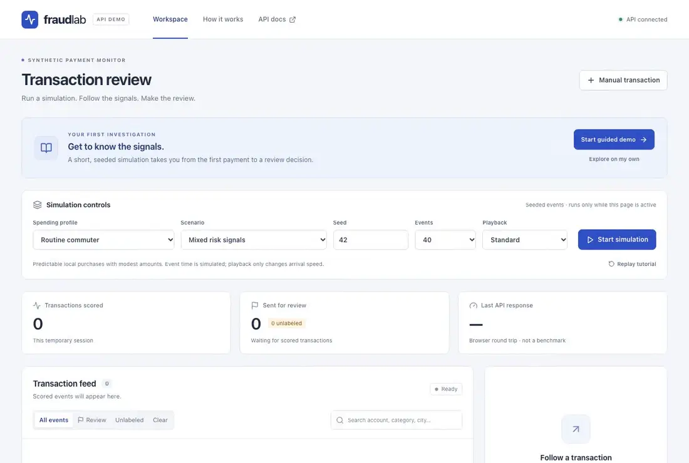

# Fraud Detection API

A portfolio API for scoring **synthetic** payment transactions, with an interactive
React demo as an independent client. Detection combines explicit
rules and a lightweight classifier. This project never processes real payments.

- [Live Fraud Lab demo](https://fraud-detection-demo-76zx.onrender.com/)
- [Interactive API docs](https://fraud-detection-demo-76zx.onrender.com/api/docs)
- [Why we picked threshold 38](#why-we-picked-threshold-38)

<details>
<summary>Watch the 26-second walkthrough</summary>

Start the guided demo, open a flagged transaction to see its score and rule signals,
then choose **Jump to review** and save a simulated fraud label.



</details>

## Status

Local API and interactive demo implemented. Product decisions are recorded in [docs/design.md](docs/design.md).
Anonymous browser/API sessions, the initial PostgreSQL migration, deterministic
simulation batches, validated transaction contracts, historical features and rule
signals are implemented.
Transaction/alert storage, idempotency, pagination and feedback are implemented.
A trained scikit-learn logistic classifier serves model-backed scoring. Startup
verifies its bundled JSON artifact; `/health` reports readiness only when the
verified model and migrated database are available. Request limits, expiry cleanup,
safe request logging and consistent API errors are implemented and tested against
PostgreSQL, including concurrent retry/cap checks. The React demo includes a guided
review, configurable simulations, manual scoring, alert investigation and feedback.
The demo and API are live on Render Free with Neon Free PostgreSQL. The first
visit after inactivity took about 45 seconds to reach the guided demo in one
cold start check. The walkthrough above shows the flow once the API is ready.

## Try the local demo

After configuring the env files below:

```sh
docker compose up -d --build
docker compose exec api alembic upgrade head
```

Open **http://localhost:5173** and choose **Start guided demo**. Inspect a review
alert, then label it fraud or legitimate. You can then change the profile,
scenario, seed, event count and playback speed for your own simulations.
See [frontend setup and design](docs/frontend.md) for Vite development, browser
tests, the generated API contract and implementation boundaries.

## Local backend development

Install Python 3.12+ and uv. From `backend/`, run `uv sync` to create `.venv` with
locked dependencies, then run:

```sh
uv run uvicorn fraud_api.main:app --app-dir src --reload --no-proxy-headers --no-access-log --log-config logging.json
```

Interactive documentation is at http://localhost:8000/docs.

Copy `.env.example` to `.env` at the repository root and in `backend/`, replacing
placeholder credentials locally. Never commit real env files. For Compose, set
the backend database host to `db` and match its password to the root env file.
Use URL-encoded credentials in database URLs. Start with `docker compose up --build`.
Docker provides PostgreSQL, the API, and the frontend's static build/API proxy.

The database binds to localhost port 5433 by default (`POSTGRES_PORT` overrides it).
Apply migrations with `docker compose exec api alembic upgrade head`.
For API clients, POST `{"mode":"api"}` to `/v1/sessions` to receive a temporary
bearer token. Browser mode sets an HttpOnly cookie and requires an `Origin` header
matching `FRAUD_FRONTEND_ORIGIN`. Responses carrying sessions are not cacheable.
When developing directly on the host, use localhost:5433 in the backend database
URL; Compose uses db:5432. For database integration tests against the local Compose
database, run `TEST_DATABASE_URL=compose uv run pytest` from `backend/` (the helper
uses the env file's credentials and localhost:5433). CI uses a separate test database.

From `backend/`, verify with `uv run pytest`, `uv run ruff check .`,
`uv run ruff format --check .`, and `uv run mypy src`.

For a complete API example against the running local containers, run
`uv run python examples/demo.py` from `backend/`. It creates a temporary session,
scores 20 synthetic events, verifies a retry, inspects alerts and saves simulated
feedback without printing or saving its token. See [API operations](docs/api-operations.md)
for limits, cleanup, logging, proxy settings and error handling.

## Synthetic simulations

With a session token, POST to `/v1/simulations/batch` using a JSON body such as:

```json
{
  "run_id": "00000000-0000-0000-0000-000000000042",
  "seed": 42,
  "profile": "commuter",
  "scenario": "mixed",
  "offset": 0,
  "count": 20
}
```

Pass the token in `Authorization: Bearer <token>`. Profiles are `commuter`,
`traveler`, and `business`; scenarios are `normal`, `burst`, `travel`, `amount`,
`category_channel`, and `mixed`. Requests return at most 50 events within a bounded
500-event run. Supply `start_time` to change the fixed event-time origin. No
background feed runs on the server. New runs use new UUIDs; the same seed/config
recreates the event contents with new IDs.

All profiles and behaviors are invented. Historical features exclude
same-time/future events and different accounts/runs. Physical travel uses earlier
in-person activity only. Rule signals cover limited history, relative amount
spikes, velocity, impossible travel and new categories/channels. Rule adjustments
are versioned and evaluated separately; they do not explain the classifier.

## Transaction and alert contract

- `POST /v1/transactions/score`: accepts the transaction shape returned by simulation.
  Identical session-scoped client IDs and payloads return the original immutable
  result; changed payloads return 409. Each session is limited to 500 transactions
  by default. Retries remain available after the cap is reached.
- `GET /v1/transactions` and `GET /v1/alerts`: newest-ingested first, with `limit`
  (1–100) and opaque `cursor`. Filters: `recommendation`, `min_score`, `max_score`,
  `account_id`, `run_id`, `feedback` (`fraud`, `legitimate`, `unlabeled`),
  `start_time`, and `end_time`. Time filters use transaction event time.
- `PATCH /v1/alerts/{alert_id}/feedback`: accepts `{"label":"fraud"}` or
  `{"label":"legitimate"}`. Feedback can change; the original score never changes.

All routes require the session cookie or bearer token. Alert IDs belonging to
another session return 404. Scoring serializes writes per session so concurrent
requests cannot create duplicate alerts or race the durable transaction cap.
Historical events are strictly earlier by event time; inserting an old event does
not rewrite previously stored score snapshots.

Scores retain feature/rule/model/formula versions, features, model probability,
rule signals, rule baseline, applied adjustment and threshold. The initial formula
is `min(100, round(100 × model_probability) + min(40, rule_score))`. The current
development-selected review threshold is now 38 after a separate recall-policy audit.
The risk index is not a fraud probability. The model probability now receives
sigmoid calibration fitted on a separate chronological cohort.

## Why we picked threshold 38

**Threshold 38 caught 74 more fraud cases and generated 37 more false alerts**
than threshold 45 in a fresh audit of 30,000 synthetic transactions. The model
and scores were the same for both policies. Lowering the cutoff sent transactions
with risk scores from 38 to 44 to review.

We chose 38 on 60,000 separate development transactions. It had the highest
precision among thresholds that reached at least 82% recall, had an estimated
lower recall bound of at least 80% when resampling whole simulation runs, and
kept precision within two percentage points of threshold 45. Threshold 39 missed
both recall requirements. Threshold 37 met them but had lower precision.
We froze the choice before evaluating it on the fresh audit.

| Outcome on the same 30,000 transactions | Threshold 45 | Threshold 38 | Change |
| --- | ---: | ---: | ---: |
| Fraud caught | 2,954 | 3,028 | +74 |
| Missed fraud (fraud left out of review) | 748 | 674 | −74 |
| False alerts (legitimate transactions sent to review) | 749 | 786 | +37 |
| Total reviews | 3,703 | 3,814 | +111 |
| Recall (share of fraud caught) | 79.79% | 81.79% | +2.00 pp |
| Precision (share of reviews that were fraud) | 79.77% | 79.39% | −0.38 pp |

The 111 extra reviews found two fraud cases for every additional false alert in
this audit. Threshold 38 passed the audit requirements of recall above 80%,
precision of at least 75%, and a precision drop of at most two percentage points.
Its approximate 95% recall interval was 78.78%–84.43% across resampled simulation
runs. The audit measures performance on synthetic data, and the interval includes
recall below 80%. [Full audit and uncertainty estimates](docs/evaluation/recall-policy/report.md).

Burst and travel runs accounted for 408 of the 674 missed fraud cases at threshold
38. The burst scenario alone missed 239 at both thresholds. Amount spikes accounted
for 48 of the 74 extra fraud cases caught and 26 of the 37 additional false alerts.
[Breakdown by scenario](docs/evaluation/recall-policy/scenario-errors.md).

## Train and evaluate

From `backend/`:

```sh
uv sync --group training
uv run --group training python training/train.py
```

The v2 pipeline compares logistic and bounded forest models, calibrates on a
separate cohort, selects candidates and thresholds on two later cohorts, and
reserves a fresh 2028 final cohort. Configuration is in
`backend/training/improved_config.json`; the committed
[improvement protocol](docs/evaluation/improvement-plan.md) records the boundaries.
Use `--development-only` to stop before final evaluation and `--evaluate-frozen`
to evaluate an existing frozen artifact. No bulk dataset is committed.

The preserved v1 combined test result was **22.8% precision, 66.4% recall**, with 1,561 false
alerts among 2,022 reviews on 6,000 synthetic events. It missed the validation
recall objective of 80%. Original evidence is in [baseline-v1](docs/evaluation/baseline-v1/report.md)
and its code is preserved at commit `c27b589`.

The [fresh v2 final evaluation](docs/evaluation/report.md) compares both versions
on the same 18,000 held-out events: v1 scored 23.4% precision / 81.0% recall, while
v2 scores **79.6% precision / 76.7% recall**. False alerts fall from 4,827 to 357,
at the cost of more missed fraud (345 to 424). V2 still misses the 80% recall
objective. Its run-cluster bootstrap recall interval is approximately 73.1%–80.4%;
these are synthetic-cohort uncertainty estimates, not real-world guarantees.

Calibration reduces final Brier loss from 0.0541 to 0.0383 on the same new model
(lower is better). See the report for scenario/profile failures, all threshold
tradeoffs and model-only comparisons. Stronger category/channel results reflect
simple generator assumptions; background fraud with no observable signal remains
largely undetectable. All results remain synthetic.

Reproduce the promoted policy after training with:

```sh
uv run --group training python training/tune_recall.py --select-only
uv run --group training python training/tune_recall.py
```

The failed initial stricter policy and the successful development decision are
preserved with source/model hashes. The 2028 threshold table did not select the
new default. Retraining with `training/train.py` alone restores threshold 45; run
the policy commands above afterward. Rebuild/restart the API to load the new policy.

Artifacts contain data-only standardized coefficients or bounded trees rather than executable pickle.
The API needs no scikit-learn/NumPy runtime dependency. Tests and training verify
exported inference against scikit-learn and online/offline feature parity.
Stored v1 score snapshots remain readable and idempotent after feature upgrades.
Use `uv run --group training pytest` to include training-specific tests. Restart the
API after retraining (`docker compose up -d --build api` for Compose).

The warm local scoring benchmark completed 4,320 requests with zero errors.
Among the tested loads, four concurrent requests gave the highest throughput
in both session modes, at 410–426 scores per second and 11–13 ms p95 latency.
At eight concurrent requests, throughput fell and p95 rose to 29–34 ms.
[Benchmark results and reproduction steps](docs/evaluation/latency.md).

To try scoring, create an API session using `/docs`, authorize with its bearer
token, request a simulation batch, then submit a returned transaction to
`/v1/transactions/score`. Inspect `/v1/alerts` and apply a feedback label.

The deployment uses free plans with no payment method. The root Dockerfile and
`render.yaml` serve the demo and API from the same origin. See [the deployment
guide](docs/deployment.md) for configuration and verification steps.
